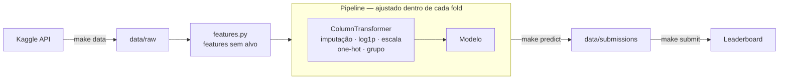

# Titanic — Duelo Final de Modelos

Solução para a competição [Titanic: Machine Learning from Disaster](https://www.kaggle.com/competitions/titanic) do Kaggle, construída como um projeto de engenharia: pacote Python testado, pipelines sem vazamento de dados, experimentos reproduzíveis e ambiente em Docker.

| Modelo final | Acurácia CV (5×3) | Score no Kaggle |
|---|---|---|
| Votação hard (LogReg + SVM + Random Forest + XGBoost) | **0.8503** | **0.77751** |

A narrativa completa, com cada decisão explicada, está no notebook [`notebooks/MOD41_EXERCICIO_DUELOFINAL.ipynb`](notebooks/MOD41_EXERCICIO_DUELOFINAL.ipynb).

---

## Sumário

- [Destaques](#destaques)
- [Resultados](#resultados)
- [Como rodar](#como-rodar)
- [Arquitetura](#arquitetura)
- [Metodologia](#metodologia)
- [Experimentos que não funcionaram](#experimentos-que-não-funcionaram)
- [Lições aprendidas](#lições-aprendidas)
- [Limitações e próximos passos](#limitações-e-próximos-passos)

---

## Destaques

- **Feature de sobrevivência do grupo sem vazamento.** Um transformer do scikit-learn que usa leave-one-out no treino e é recalculado dentro de cada fold. Sozinha, levou a regressão logística de 0.8294 para 0.8440.
- **Validação rigorosa.** `RepeatedStratifiedKFold` (5×3), comparação pareada fold a fold e seeds separadas para busca e avaliação, para medir o otimismo do tuning.
- **Critérios de decisão definidos antes dos resultados.** Balanceamento e a regra woman-child-group foram testados e descartados com base em evidência.
- **Reprodutível de ponta a ponta.** Lock de dependências, seeds fixas e Docker: o container reproduz as métricas da máquina local até a 4ª casa decimal.
- **Qualidade de código.** 65 testes, ruff (type hints e docstrings Google obrigatórios), pre-commit e Conventional Commits, um commit por etapa.

---

## Resultados

### Evolução do projeto

| Etapa | Modelo | Acurácia CV | Kaggle |
|---|---|---|---|
| Referência | "Só mulheres sobrevivem" | — | ~0.766 |
| Baseline | Regressão logística, parâmetros padrão | 0.8373 | — |
| Tuning | Random Forest tunado | 0.8485 | 0.77751 |
| Ensemble | **Votação hard** | **0.8503** | **0.77751** |

### Duelo final

| Modelo | Acurácia | Desvio | ROC AUC | Win rate vs RF |
|---|---|---|---|---|
| **Votação hard** | **0.8503** | **0.0156** | — | 67% |
| Random Forest tunado | 0.8485 | 0.0183 | 0.8894 | — |
| Stacking | 0.8444 | 0.0188 | 0.8930 | 33% |
| Votação soft | 0.8440 | 0.0167 | **0.8940** | 33% |

Todos os números de CV usam os mesmos 15 folds (5 folds × 3 repetições, seed 42). Os resultados de cada etapa estão em [`reports/`](reports/).

---

## Como rodar

### Pré-requisitos

- **Credencial do Kaggle:** gere um token em [kaggle.com/settings](https://www.kaggle.com/settings) (**Generate New Token**) e salve em `~/.kaggle/access_token`:

  ```bash
  mkdir -p ~/.kaggle
  read -rsp "Cole o token: " KTOKEN && printf '%s' "$KTOKEN" > ~/.kaggle/access_token && unset KTOKEN; echo
  chmod 600 ~/.kaggle/access_token
  ```

- **Regras da competição aceitas:** clique em **Join Competition** na [página do Titanic](https://www.kaggle.com/competitions/titanic). Sem isso, o download retorna erro 403.

> Se o Kaggle CLI disser que a autenticação é necessária mesmo com o arquivo salvo, verifique se não existe uma variável `KAGGLE_API_TOKEN` definida no seu shell (por exemplo, no `~/.bashrc`). Ela tem prioridade sobre o arquivo.

### Opção 1: Docker (recomendado para avaliar o projeto)

Requer apenas o Docker.

```bash
git clone https://github.com/RToyoyama/titanic-duelo-final.git
cd titanic-duelo-final
make docker-build      # constrói a imagem
make docker-data       # baixa os dados do Kaggle
make docker-test       # roda os 65 testes
make docker-baseline   # qualquer alvo do Makefile funciona como docker-<alvo>
```

Os diretórios `data/`, `reports/` e `models/` e o token do Kaggle são montados por volume: nada disso fica gravado na imagem.

- **Windows:** use WSL 2 com o Docker Desktop e ative a integração em *Settings → Resources → WSL Integration*. Mantenha o projeto no sistema de arquivos do Linux (`~/...`), não em `/mnt/c/...`.
- **Mac com chip Apple (ARM):** o lock fixa o pacote `nvidia-nccl-cu12`, que só existe para x86. Construa com `docker build --platform linux/amd64 -t titanic-duelo .`.
- **Submissão:** rode `make submit` no host, fora do container. A mensagem da submissão usa o hash do commit, e o `.git` não entra na imagem.

### Opção 2: Ambiente local

Requer Python 3.11. Se o seu sistema não tiver essa versão, o [uv](https://docs.astral.sh/uv/) baixa uma sem precisar de `sudo`.

```bash
git clone https://github.com/RToyoyama/titanic-duelo-final.git
cd titanic-duelo-final
uv venv --python 3.11 --seed .venv     # ou: python3.11 -m venv .venv
source .venv/bin/activate
pip install -r requirements.lock
make install                            # pacote em modo editável + hooks de pre-commit
make data
make test
```

### Comandos

| Comando | O que faz | Tempo aprox. |
|---|---|---|
| `make data` | Baixa os dados do Kaggle para `data/raw/` | segundos |
| `make features` | Gera a camada `data/processed/` | segundos |
| `make test` | Roda os 65 testes | ~10 s |
| `make lint` / `make format` | Verifica / corrige o estilo com ruff | segundos |
| `make baseline` | Duelo baseline dos 4 modelos | ~1 min |
| `make balance` | Experimento de balanceamento de classes | ~2 min |
| `make tune` | Tuning de hiperparâmetros | ~10 min |
| `make ensemble` | Diagnóstico de diversidade e ensembles | ~5 min |
| `make wcg` | Experimento woman-child-group | ~5 min |
| `make predict` | Treina os modelos finais e gera as submissões | ~1 min |
| `make submit` | Envia a submissão ao Kaggle (`MODEL=random_forest` para trocar) | segundos |

O `make tune` sobrescreve `reports/best_params.json`. Para reproduzir as submissões sem refazer o tuning, rode direto `make predict`, que usa os parâmetros já versionados.

---

## Arquitetura

### Estrutura

```
titanic-duelo-final/
├── data/
│   ├── raw/               # dados originais do Kaggle (não versionados)
│   ├── processed/         # features geradas (não versionadas)
│   └── submissions/       # CSVs enviados ao Kaggle
├── models/                # modelos treinados .joblib (não versionados)
├── notebooks/
│   ├── 01_eda.ipynb                       # análise exploratória
│   └── MOD41_EXERCICIO_DUELOFINAL.ipynb   # notebook de entrega
├── reports/               # resultados de cada experimento + figuras
├── src/titanic/
│   ├── config.py          # caminhos, seed e constantes
│   ├── data.py            # leitura e validação da camada raw
│   ├── features.py        # features determinísticas (não usam o alvo)
│   ├── transformers.py    # transformers que aprendem dos dados (dentro da CV)
│   ├── preprocessing.py   # ColumnTransformer
│   ├── models.py          # catálogo de modelos e montagem de pipelines
│   ├── evaluate.py        # duelo com CV repetida e comparação pareada
│   ├── balancing.py       # experimento de balanceamento
│   ├── tuning.py          # GridSearchCV e RandomizedSearchCV
│   ├── ensemble.py        # diversidade, votação e stacking
│   ├── wcg.py             # experimento woman-child-group
│   └── predict.py         # treino final e submissão
├── tests/                 # 65 testes (pytest)
├── Dockerfile
├── Makefile
├── pyproject.toml
└── requirements.lock      # versões exatas de todas as dependências
```

### Fluxo de dados



A regra central do projeto: **toda estatística aprendida dos dados fica dentro do pipeline**. Features que só transformam a própria linha (Title, FamilySize, Deck) são calculadas antes. Imputação, escala e a sobrevivência do grupo são ajustadas em cada fold, para que a validação nunca veja informação do próprio resultado.

---

## Metodologia

### 1. EDA orientada a decisões

Cada análise termina numa decisão de modelagem. Os principais achados: sexo e classe dominam; o título no nome resume sexo, idade e status; grupos de ticket tendem a sobreviver ou morrer juntos; faltar cabine já é informação; `Fare` é o preço do ticket, não por pessoa; o desbalanceamento é leve (62/38). Detalhes em [`notebooks/01_eda.ipynb`](notebooks/01_eda.ipynb).

### 2. Features

| Feature | Descrição |
|---|---|
| `Title` | Mr, Mrs, Miss, Master ou Rare, extraído do nome |
| `FamilySize` / `FamilyBand` | Tamanho da família e faixas Alone / Small (2–4) / Large (5+), pela relação em U com a sobrevivência |
| `Deck` / `HasCabin` | Deck agrupado (ABC, DE, FG, U) e indicador de cabine registrada |
| `TicketGroupSize` | Passageiros por ticket, contando treino e teste |
| `FarePerPerson` | Tarifa dividida pelo tamanho do grupo, com `log1p` |
| `Age` | Imputada pela mediana do Title (`GroupMedianImputer`) |
| `group_survival` | Sobrevivência dos **outros** membros do grupo de ticket (`GroupSurvivalEncoder`, leave-one-out) |

### 3. Pré-processamento

`ColumnTransformer` com imputação, `log1p` na tarifa, `StandardScaler` (ligado para SVM e regressão logística, desligado para árvores) e one-hot com `handle_unknown="ignore"`.

### 4. Validação

`RepeatedStratifiedKFold` 5×3. Com 891 linhas, uma única divisão em 5 folds variava 0,7 p.p. Os modelos são comparados fold a fold, com diferença média e win rate.

### 5. Balanceamento

Nenhum × `class_weight` × SMOTE (via `imblearn.Pipeline`, aplicado só no fit). Não balancear venceu em 3 de 4 modelos.

### 6. Tuning

`GridSearchCV` para regressão logística e SVM; `RandomizedSearchCV` (40 iterações) para Random Forest e XGBoost. A busca usa uma seed de CV e a reavaliação outra, o que revelou 0,77 p.p. de otimismo no XGBoost. O Random Forest ganhou +2,13 p.p. ao limitar a profundidade das árvores.

### 7. Ensembles

Antes de combinar, medi a correlação dos erros out-of-fold: os modelos formam duas famílias (lineares e árvores, correlação 0.82 dentro de cada uma, 0.67–0.71 entre elas). A votação hard venceu; votação soft e stacking tiveram o melhor AUC, mas a pior acurácia.

---

## Experimentos que não funcionaram

Documentados porque testar e descartar com evidência também é resultado.

| Experimento | Resultado | Por quê |
|---|---|---|
| SMOTE e `class_weight` | Pioraram a acurácia em 3 de 4 modelos | Deslocam o limiar a favor da classe minoritária; com 62/38 isso gera mais erros que acertos |
| Stacking e votação soft | Melhor AUC, pior acurácia | Combinar probabilidades puxa os valores para o meio e passageiros na fronteira mudam de lado |
| Regra woman-child-group | Win rate de 7–33%; no máximo 1 previsão alterada no teste | Redundante: `group_survival` + `Title` + `Sex` já capturavam o padrão |

---

## Lições aprendidas

1. **Toda estatística aprendida dos dados vai dentro do pipeline.** Imputação, escala, SMOTE e target encoding fora da CV inflam o score.
2. **Diferença na média não é diferença real.** O XGBoost "liderou" o baseline vencendo só 40% dos folds.
3. **O melhor score de uma busca é otimista.** Reavaliar com outra seed mede esse viés.
4. **O melhor modelo depende da métrica.** O campeão em AUC foi o último em acurácia.
5. **Defina o critério de decisão antes de ver o resultado.** Isso evita perseguir oscilações do leaderboard.
6. **A CV é uma estimativa, não uma promessa.** CV de 0.85 virou 0.78 no Kaggle: escolhas acumuladas sobre a mesma CV somam otimismo, e o teste tem só 418 passageiros.

---

## Limitações e próximos passos

- **Distância entre CV e Kaggle (~7 p.p.).** Investigar com validação adversarial se treino e teste têm distribuições diferentes.
- **Espaço de busca do Random Forest.** `max_depth` e `max_features` ficaram na borda do espaço testado.
- **Limiar da votação soft.** Ela tem o melhor AUC; otimizar o limiar de decisão pode convertê-lo em acurácia.
- **SMOTENC.** Trata colunas categóricas corretamente, ao contrário do SMOTE.
- **`fit_time` nos relatórios.** O tempo de treino varia a cada execução e gera diffs falsos nos CSVs versionados; deveria ficar num arquivo separado.
- **Uso transdutivo.** `TicketGroupSize` usa passageiros do teste. É válido no Kaggle, mas não seria reproduzível em produção.

---

## Stack

Python 3.11 · pandas · scikit-learn · XGBoost · imbalanced-learn · matplotlib · seaborn · pytest · ruff · pre-commit · Docker · Kaggle CLI

---

**Autor:** Renan Toyoyama · [GitHub](https://github.com/RToyoyama)
